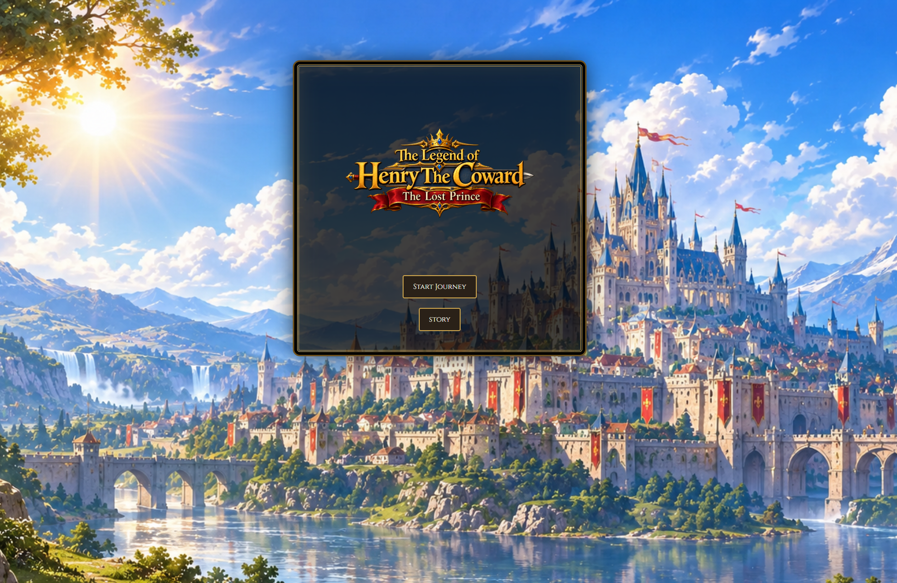

# Choice-Based-Adventure

### getting started
- to play the game, click this [Link](https://anas-ntafk.github.io/Choice-Based-Adventure/)

The legend of Henry: the lost prince is A choice-based adventure game where you play as the Kingdom's second prince's Royal Gaurd Henry. players make decisions that shape the progression and outcome of the story. Every choice can lead to different events, challenges, and endings.
to win the game the player must find the prince with a favorable outcome.

### Credits 
- background images and scene images were genrated using chatgpt.com
- "YOU DIED" image is from studio fromsoftware games
- this section of css was made with help of chatgpt:
        box-shadow:
        0 0 0 6px #000,                   
        0 0 0 9px #6b4f1d,                
        0 0 50px rgba(0, 0, 0, 0.9),      
        inset 0 0 40px rgba(201, 162, 77, 0.15);
- this section of css was made with help of chatgpt:
    .objective.done::before {
        content: "✅";
}
- the main character backstory was inspired from the backstory of the main character of the game "Kingdom Come Deliverance"

### technologies used 
- HTML
- CSS
- JAVASCRIPT

### Next steps
- making the objectives fail 
- adding sound effects for the choices buttons
- background sounds for some scenes 
- narration  
